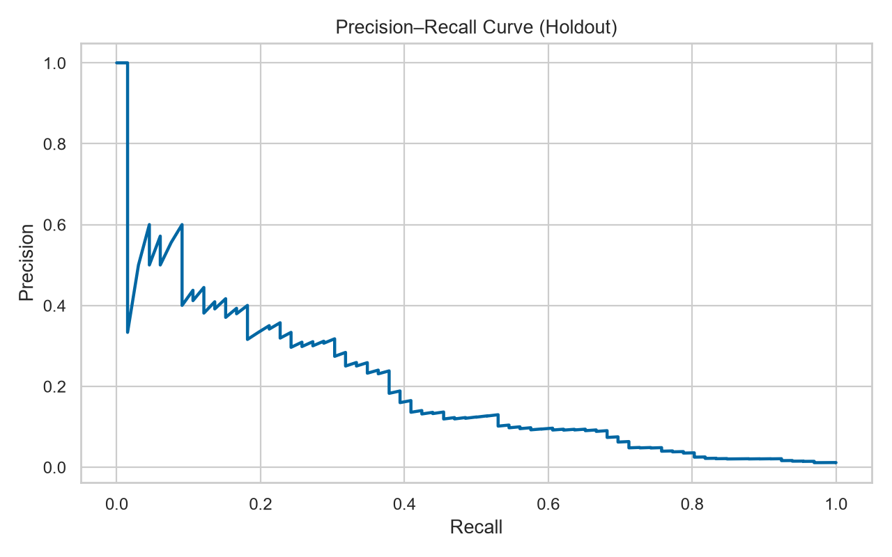

# 01｜取引リスク・異常検知

## 結論

30,000件の取引に対し、単純なAccuracyではなく**見逃し損失と人手確認コスト**を基準に運用閾値を設計しました。ホールドアウト期間でROC-AUC **0.848**、PR-AUC **0.200**。推奨閾値0.71ではRecall **68.2%**、Precision **8.6%**、アラート523件です。不正率1.2%に対し、アラートの的中率を約7倍へ高めています。

## Business question

不正取引は少数で、全件を人手確認できません。限られた確認能力の中で、どの取引をアラートにするかを決めます。

## Approach

1. 取引額、時間帯、端末信頼性、国不一致、認証失敗、短時間取引回数を含む合成データを生成
2. 過去80%で学習し、新しい20%で検証して将来情報の混入を回避
3. Logistic Regressionで説明可能なリスクスコアを作成
4. 見逃し50,000円、レビュー500円という仮定で、期待総コストが最小の閾値を選択
5. 上位500件の運用リストと、要因・PR曲線を出力

## Deliverables

- `run_analysis.py`：データ生成から分析・出力までの実行可能コード
- `data/transactions.csv`：30,000件の合成取引
- `outputs/summary.html`：採用担当・面接用の要約
- `outputs/top_500_alerts.csv`：現場レビュー用リスト
- `outputs/threshold_cost_table.csv`：閾値別のPrecision、Recall、コスト
- `dashboard_spec_ja.md`：Power BI画面設計
- `interview_60sec_ja.md`：面接説明

## Limitations / next steps

合成データのため実際の不正パターン、ラベル遅延、データドリフトは反映されません。実務では金額別損失、担当者処理能力、顧客ブロックの影響、モデル校正、属性別の誤検知率を継続監視します。

