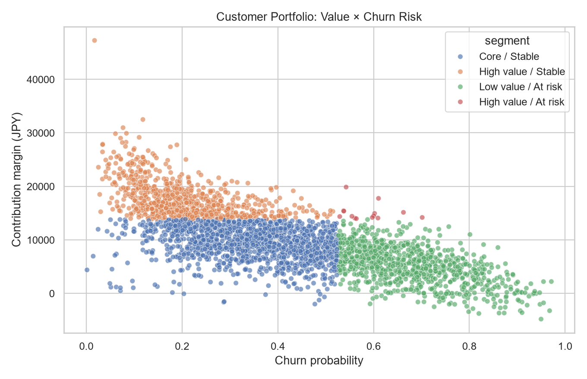

# 02｜顧客収益性 × 離反予測

## 結論

8,000人・12か月の顧客データをSQLで統合し、売上ではなく**収益－サービス原価－特典－期待信用損失**で貢献利益を定義しました。離反モデルは検証ROC-AUC **0.759**。高収益かつ高離反リスクの29人を優先対応先として抽出し、期待利益リスク額は約26万円です。

## Business question

営業担当者の工数が限られる中、全顧客へ一律施策を行わず、誰を優先してフォローすべきかを決めます。

## Approach

1. 顧客属性と月次利用実績を別テーブルとして生成
2. SQLのCTE、条件付き集計、JOIN、NTILEで顧客分析マートを作成
3. 過去11か月の利用低下、苦情、デジタル利用、収益性から12か月目の離反を予測
4. 貢献利益上位25%かつ離反確率上位30%を優先対象に設定
5. 期待利益リスク額で優先順位を付け、上位500人の施策リストを出力

## Deliverables

- `analysis.sql`：SQL顧客マート（CTE / JOIN / window function）
- `run_analysis.py`：生成、SQLite格納、モデリング、可視化
- `data/customer_analytics.db`：再現可能なSQLiteデータベース
- `outputs/retention_priority_top500.csv`：営業施策リスト
- `outputs/segment_summary.csv`：セグメント別KPI
- `dashboard_spec_ja.md`：Power BI画面設計
- `interview_60sec_ja.md`：面接説明

## Limitations / next steps

予測スコアだけでは施策効果を証明できません。実務では、接触あり／なしのホールドアウト群を設定し、離反率ではなく純増利益を評価します。値引きや特典の原価、チャネル別接触コスト、顧客同意も追加します。

