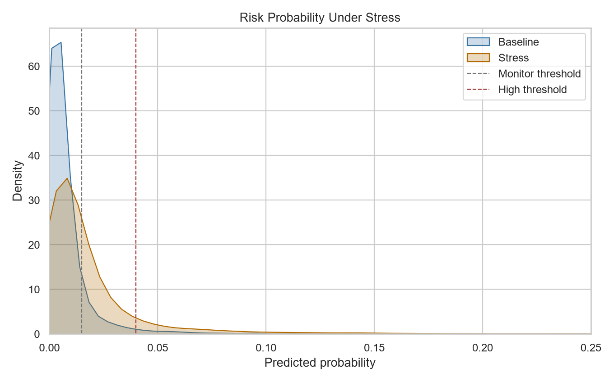

# 03｜法人財務の早期警戒・ストレステスト

## 結論

5,000社・7四半期の財務指標から、翌四半期の要注意化を予測しました。過去6四半期で学習し、第7四半期で検証したROC-AUCは **0.854**、PR-AUCは **0.157**。売上成長率−10pt、利益率−3〜4pt、利払い能力低下を想定したストレスで、Highリスクは126社から469社へ増加し、新たに343社がHighへ移行しました。

## Business question

審査・営業担当者がすべての取引先を同じ頻度で確認できない中、どの法人を先にモニタリングすべきかを決めます。

## Approach

1. 売上成長率、EBITDA利益率、営業CF、流動比率、Debt/EBITDA、利払能力、DSO、延滞日数を生成
2. 時間順に学習・検証を分け、将来情報の混入を回避
3. 説明性の高いLogistic Regressionで早期警戒確率を算出
4. BaselineとStressの両方でリスク帯を付与し、移行数を集計
5. 確率、悪化幅、簡易エクスポージャーを含む上位500社watchlistを出力

## Deliverables

- `run_analysis.py`：財務データ生成、時系列検証、ストレステスト
- `data/sme_quarterly_financials.csv`：5,000社×7四半期
- `outputs/early_warning_watchlist_top500.csv`：担当者レビュー用リスト
- `outputs/risk_band_migration.csv`：Baseline→Stress移行表
- `outputs/risk_feature_importance.csv`：要因説明
- `dashboard_spec_ja.md`：Power BI画面設計
- `interview_60sec_ja.md`：面接説明

## Limitations / next steps

合成データであり、実際のデフォルト定義、財務業種差、担保・保証、定性情報は含みません。実務では確率校正、期待損失（PD×LGD×EAD）、業種別モデル、審査規程、説明可能性、公平性、モデルドリフトを追加検証します。

